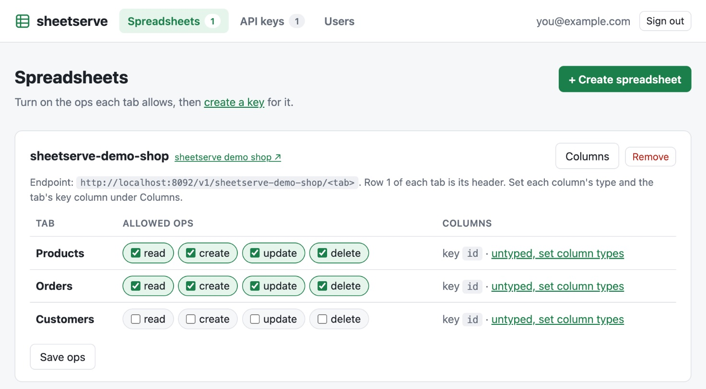
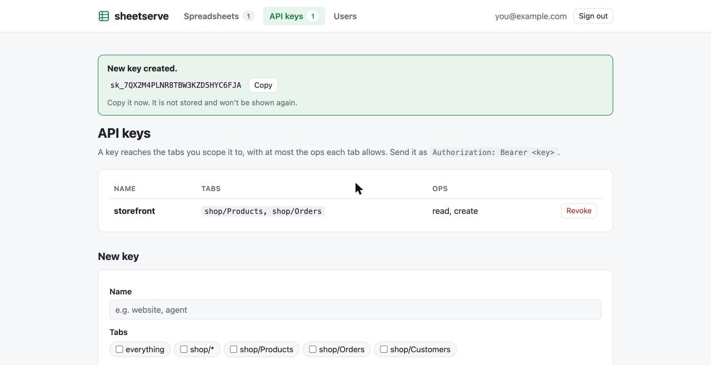
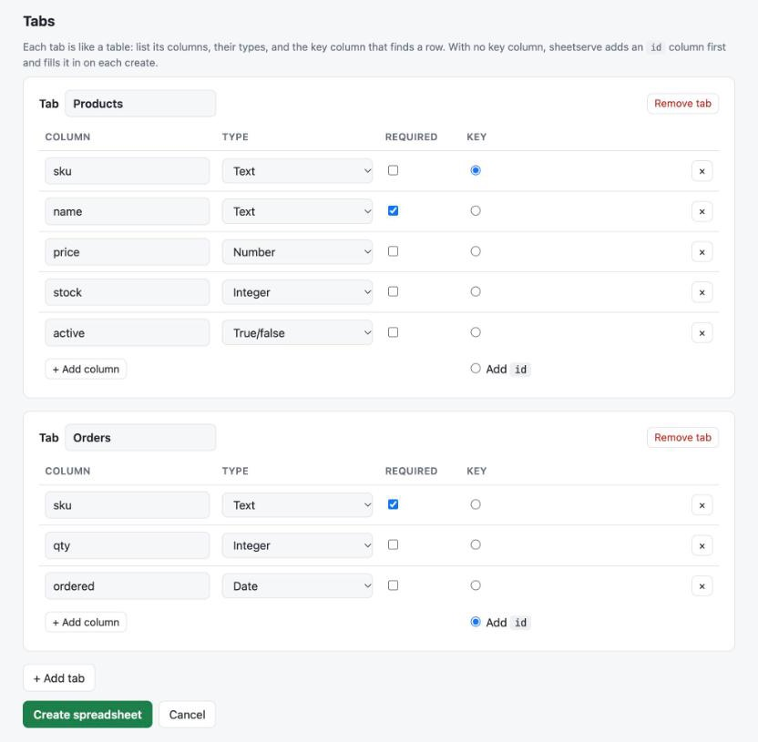

# sheetserve

Self-hosted REST API and MCP server for Google Sheets. It is one binary.
People sign in with Google and manage their spreadsheets, tabs and API keys in a web dashboard, which has a Spreadsheets page and an API keys page.
The server keeps them in SQLite.

- Each tab gets `GET / POST / PATCH / DELETE` routes.
- You set the allowed operations for each tab, and you can hide columns.
- API keys are scoped to tabs and operations. The database stores only their SHA-256 hashes.
- `/mcp` serves an MCP endpoint. Each key gets tools for the tabs it can reach, built from the header row.
- `/openapi.json` serves an OpenAPI 3.1 spec. It lists only the tabs, ops and columns the caller's key can use.
- When `SHEETSERVE_CACHE_TTL` is set, a per-tab cache stores reads. Any write to a tab clears that tab's cache.
- Every request is logged as JSON, with the key name and the reason for any refusal.



## Setup

Google Cloud setup:

1. Enable the Google Sheets API and the Google Picker API.
2. Configure the OAuth consent screen with the scopes `openid`, `email` and `.../auth/drive.file`.
   `drive.file` lets the app open only the spreadsheets a user picks, so it does not need restricted-scope verification.
   While the app is in "Testing" status, Google expires refresh tokens after 7 days and only test users can sign in.
   Publish the app for real use.
3. Create an OAuth client of type "Web application" with the redirect URI `<base URL>/auth/callback`.
4. Create an API key for the Picker, restricted to the Picker API and your site.

Environment variables:

| Variable | Value |
|---|---|
| `SHEETSERVE_BASE_URL` | Public URL, such as `https://sheets.example.com`. On Render it defaults to `RENDER_EXTERNAL_URL`. |
| `SHEETSERVE_SECRET` | 32 random bytes, base64 (`openssl rand -base64 32`). Encrypts stored refresh tokens. Keep it stable. |
| `GOOGLE_CLIENT_ID`, `GOOGLE_CLIENT_SECRET` | From the OAuth client. |
| `GOOGLE_PICKER_API_KEY` | The Picker API key. |
| `GOOGLE_PROJECT_NUMBER` | The Cloud project number, so picked files are granted to the app. |
| `SHEETSERVE_DB` | Optional. SQLite file path. Defaults to `sheetserve.db`. |
| `SHEETSERVE_CACHE_TTL` | Optional. How long to cache reads, such as `60s`. Defaults to no cache. |
| `SHEETSERVE_CORS_ORIGINS` | Optional. Comma-separated browser origins allowed to call the API. See [Browsers](#browsers-cors). |
| `PORT` | Optional. Listen port. Defaults to `8085`. |

```sh
cp .env.example .env   # fill it in
mise run run           # or: go run ./cmd/server, with the variables exported
```

Sign in, add a spreadsheet from your Drive, and turn on the ops you want for each tab. New tabs start with no ops enabled.
Then create an API key on the API keys page. Row 1 of each tab is its header row.



Each tab has a key column, which identifies a row in `GET`, `PATCH` and `DELETE /v1/<sheet>/<tab>/<key>`. It is `id` unless you
name another column, such as `email` or `sku`, on the tab's row in the dashboard.

- With `id` as the key, the server generates the id of each row it creates, and clients can't set or change it.
- With another key, a create must include it and its value must be new. An update can't change it.
- A key value that more than one row holds returns `409`, so the server never guesses which row you meant.
- A tab whose header has no key column can only be listed. Its other routes return `403`.

To start from nothing, create a blank spreadsheet in the dashboard instead. List one tab per line with its columns:

```text
Orders: item, qty, price
Customers: name, email
```

The server creates the spreadsheet in your Drive with your Google account, writes and freezes each header row,
and puts an `id` column first unless you list one. To use another key column, mark it with `*`, as in `Products: *sku, name, price`.
That tab gets no `id` column, and its key column is set already. `drive.file` covers files the app creates, so you don't need to pick it.



A key acts through the Google account of the user who made it.

## Users

The first person to sign in becomes the admin. Everyone after that waits as pending until an admin approves them on the Users page.
Pending users can't add spreadsheets or make keys, and their keys return `403`.

| Role | Can |
|---|---|
| `admin` | Everything a member can, and approve users, change their roles, or remove them |
| `member` | Add spreadsheets, set tab rules, and make keys that work |
| `pending` | Nothing yet. They see a "waiting for approval" page |

Each user only sees their own spreadsheets and keys, admins included. Removing a user deletes their spreadsheets and keys.
The server always keeps at least one admin.

## API

```sh
curl -H "Authorization: Bearer $KEY" localhost:8085/v1/shop/Products
curl -H "Authorization: Bearer $KEY" "localhost:8085/v1/shop/Orders?item=mug&limit=10"
curl -g -H "Authorization: Bearer $KEY" "localhost:8085/v1/shop/Orders?qty[gte]=2&item[contains]=tea&sort=-qty"
curl -H "Authorization: Bearer $KEY" localhost:8085/v1/shop/Orders/$ID
curl -H "Authorization: Bearer $KEY" -d '{"item":"mug","qty":2}' localhost:8085/v1/shop/Orders
curl -H "Authorization: Bearer $KEY" -X PATCH -d '{"qty":3}' localhost:8085/v1/shop/Orders/$ID
curl -H "Authorization: Bearer $KEY" -X DELETE localhost:8085/v1/shop/Orders/$ID
```

Query parameters other than `limit`, `offset` and `sort` are filters. `col=value` matches the value exactly.
`col[op]=value` uses an operator: `eq`, `ne`, `gt`, `gte`, `lt`, `lte` or `contains`.
`gt`, `gte`, `lt` and `lte` compare numerically when both values are numbers, and as strings otherwise, so ISO dates work.
In a column that mixes numbers and text, numbers sort before text.
`contains` ignores case. A row must match every filter.

`sort=col` sorts ascending and `sort=-col` sorts descending, with the same comparison rules. Sorting happens before `limit` and `offset`.

A successful create returns `201`. Errors use these status codes:

| Status | Cause |
|---|---|
| `400` | An unknown or hidden column, an unknown filter operator, a bad `limit` or `offset`, an `id` field in a create or update, a create without the tab's key column, a change to a row's key column, or an update with no fields |
| `401` | A missing or invalid key |
| `403` | The key or the tab does not allow the operation, or the tab has no key column |
| `404` | An unknown tab or row |
| `409` | A create with a key value that exists, or a key value that more than one row holds |
| `502` | A Google API error |

Error bodies look like `{"error": "..."}`. Google API error details go to the log only.

Writes use `RAW` input, so the server never runs client data as a formula. An update changes only the cells you send,
so formulas in other columns stay in place.

## Browsers (CORS)

CORS is off by default. To let a web app call the API, list its origins in `SHEETSERVE_CORS_ORIGINS`:

```sh
SHEETSERVE_CORS_ORIGINS=https://app.example.com   # or *
```

A key used in a browser is visible to anyone who loads the page. Give browser apps a read-only key scoped to the tabs they need.

## MCP

Point an MCP client at `http://host:8085/mcp` and send `Authorization: Bearer <key>`.
Each tab gets the tools `<sheet>_<tab>_list`, `_get`, `_create`, `_update`, and `_delete`, filtered by what the key can do.
`_list` takes the same filter operators, `sort`, `limit` and `offset` as the REST API.

## Deploy

`docker build -t sheetserve .`, or use `render.yaml` on Render.
After deploying on Render, fill in the `GOOGLE_*` and `SHEETSERVE_SECRET` variables. The database lives on the service's disk at `/var/data`.

## Development

The repo uses [mise](https://mise.jdx.dev) for its tools (Go and golangci-lint, pinned in `mise.toml`) and its tasks.

```sh
mise install          # install the pinned tools
mise tasks            # list the tasks
mise run check        # go vet, golangci-lint and the unit tests
mise run build        # build ./sheetserve
mise run run          # run the server
mise run db:new <name> # create a database migration
```

The SQLite schema lives in `internal/db/migrations` as [goose](https://github.com/pressly/goose) migrations.
They are built into the binary, and the server applies new ones when it opens the database.

mise loads `.env` into every task, if the file exists. Copy `.env.example` to `.env` and fill it in.

`mise run test:live` runs `TestLive` against a real spreadsheet. It creates a scratch tab and deletes it afterwards.
It needs `SHEETSERVE_LIVE_SHEET_ID`, set to a spreadsheet that the test's Google credentials can edit.
The test uses Application Default Credentials, such as a key file named by `GOOGLE_APPLICATION_CREDENTIALS`.
The server itself does not use them.
Without `SHEETSERVE_LIVE_SHEET_ID`, the test skips.

CI (`.github/workflows/ci.yml`) runs `mise run check` and `mise run build` on pushes to `main` and on pull requests.

## Known limits

- Run one instance only. The cache, the write locks and the per-user state live in the process.
- Two users who add the same spreadsheet do not share write locks.
- If a user revokes the app's access in their Google account, their keys return `502` until they sign in again.
- An update or delete finds its row by key just before it writes. If someone inserts or deletes rows by hand in the sheet at that moment, the write can land on the wrong row.
- Filters read the whole tab. Very large tabs will be slow until the cache has them.
